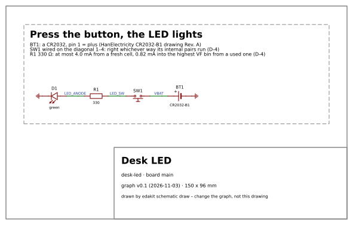
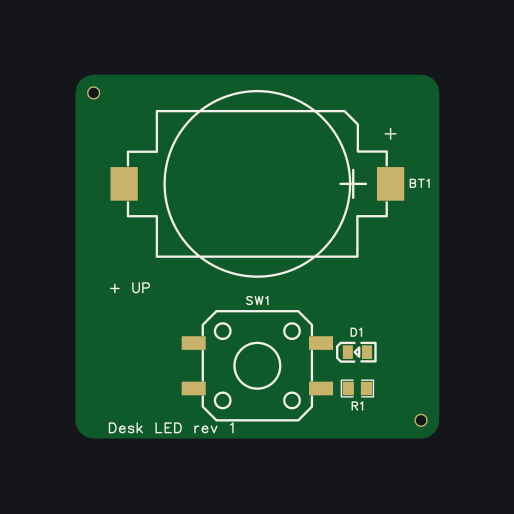

# Desk LED

**An example repository for [edakit](https://github.com/tgd1975/edakit)**, circuit design as code with Claude Code.
A small board for the desk: a CR2032 coin cell, a push button and a green LED. Press the button and the LED lights.
Every file edakit works on is here, from the requirements to the routed board, so you can see what a real project
built with edakit looks like next to the walkthroughs in edakit's own repository.

| The circuit, drawn by `edakit schematic draw` | The board's top side, after `edakit silk apply` |
| --- | --- |
|  |  |

## Where it stands

- **Circuit:** designed and reviewed. The datasheet check (M-1) and the regulatory review (M-6) are signed.
- **Layout:** round 1 done in EasyEDA Pro. All parts sit on top; there are 2 vias, both hidden; DRC 0.
- **Copper on both faces:** GND poured on top, VBAT on the bottom.
- **Not released, not ordered yet.** JLCPCB is to make 5 boards and place the SMD parts on the top side.

## What is where

| File | What it holds |
| --- | --- |
| [`edakit.toml`](edakit.toml) | the project: boards, assembly, order, cost, the project's scripts |
| [`hardware/requirements.toml`](hardware/requirements.toml) | what the circuit must do, in the owner's words (N-1, R-1 to R-5) |
| [`hardware/graph.toml`](hardware/graph.toml) | the circuit: parts, nets, the purpose; `graph.json` beside it is generated |
| [`hardware/parts/`](hardware/parts/) | one entry per part, with pins, ratings and the datasheet check |
| [`hardware/sim.json`](hardware/sim.json) | the simulation (ngspice): a fresh, a used and a reversed cell, button pressed and released |
| [`hardware/schematic.toml`](hardware/schematic.toml) | how the schematic is arranged |
| [`hardware/boards/main.toml`](hardware/boards/main.toml) | the board file: outline, placement, keep-outs, pours, silkscreen |
| [`hardware/signoff.json`](hardware/signoff.json) | the sign-offs, bound to the hashes of circuit and layout |
| [`hardware/scripts/`](hardware/scripts/) | the project's own scripts, registered in `edakit.toml` |
| [`docs/decisions.md`](docs/decisions.md) | every decision, with its reason (D-1 to D-7) |

## Try it

In a clone, without the plugin and without an EDA program, run edakit's checks and the simulation:

```bash
uvx --from git+https://github.com/tgd1975/edakit edakit check
uvx --from git+https://github.com/tgd1975/edakit edakit sim
```

With Claude Code, `.claude/settings.json` enables the edakit plugin for the repository; the layout steps need EasyEDA
Pro (see edakit's [setup](https://tgd1975.github.io/edakit/)).

## What edakit could not do yet

The layout needed two things edakit 1.1.0 lacks, both written down in [D-6](docs/decisions.md):

- **Keep a copper pour out of a keep-out.** The project script
  [`pour_keepouts.py`](hardware/scripts/pour_keepouts.py) sets the region in EasyEDA.
- **Fill the pours with easyeda-mcp-pro 1.8.0.** The fills were done one by one after a restart of EasyEDA.

Both went to edakit as proposals ([#335](https://github.com/tgd1975/edakit/issues/335),
[#336](https://github.com/tgd1975/edakit/issues/336)), together with six more the project found
([#337](https://github.com/tgd1975/edakit/issues/337) to [#342](https://github.com/tgd1975/edakit/issues/342)).

## Licence

MIT – see [LICENSE](LICENSE). Nothing in this repository is someone else's work:

| Path | Source | Licence |
| --- | --- | --- |
| `hardware/parts/` | facts quoted from the datasheets and catalogue pages each entry names in `sources` (pins, ratings, order codes); the datasheets are not in the repository | MIT, as the rest |
| `hardware/boards/main.geometry.json` | pad positions edakit measured from the parts' library footprints in EasyEDA Pro | MIT, as the rest |

The check `licence` ([`hardware/scripts/licence_check.py`](hardware/scripts/licence_check.py), stage LIC of the
release gate and a step of the pre-commit hook) keeps it so. It fails on a file of a kind that usually comes from
someone else, such as a datasheet PDF, a 3D model, a library footprint or a photo, unless a row above names it with its
licence ([D-7](docs/decisions.md)).

This is a reading of the licences, not legal advice.
